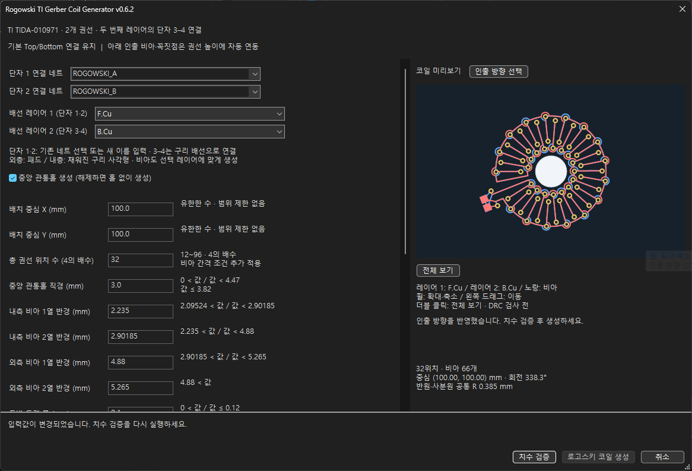
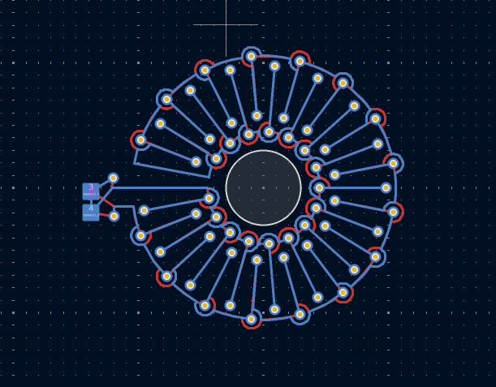
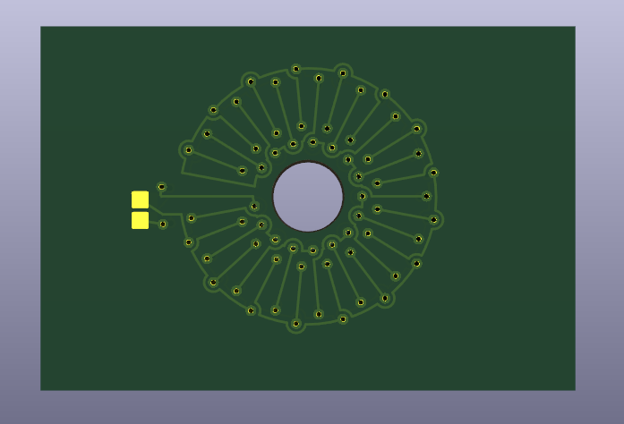

# KiCAD_RogowskiCoil

TI TIDA010971E2.0의 Gerber 및 NC Drill 데이터를 바탕으로 PCB 로고스키 코일을 생성하는 **KiCad PCB 편집기용 플러그인**입니다. 선택한 두 구리 레이어에 권선을 배치하고 두 번째 레이어의 단자 3·4에서 연결하며, 코일 치수와 위치를 조정할 수 있습니다.

[버전별 변경 이력](CHANGELOG.md)에서 버전별 기능과 동일 버전 추가 수정 내역을 확인할 수 있습니다.

## 생성 예시

### 로고스키코일 풋프린트 생성기



### PCB 배선



### PCB 3D 보기



## 주요 기능

- 원본 기반 32개 권선 위치 모드 및 위치 수를 바꾸는 가변 모드
- 단자 1·2에 사용할 PCB 네트 선택 또는 새 네트 이름 입력
- 활성 구리 레이어 2개 선택, 내층 단자는 채워진 구리 사각형으로 생성
- 두 번째 레이어의 단자 3·4를 구리 배선으로 연결
- 배치 중심, 회전각, 4개 비아 열 반경, 트랙 폭, 비아 및 드릴 크기 설정
- 중앙 개구부 및 독립 시험용 원형 PCB 외곽선 생성 옵션
- 입력 치수, 비아 간격 및 서로 다른 권선 사이의 구리 겹침 검사
- 치수 검증 중 검사 진행률과 상태 표시, 생성 중 PCB 패턴 추가 및 화면 갱신 진행률 표시
- 치수 검증 통과 후에만 생성 가능. 파라미터나 옵션 변경 시 재검증 필요
- 입력창 오른쪽에 코일 미리보기 표시. 입력 변경 후 자동 갱신되며, 앞면·뒷면 배선, 비아, 중앙 홀 및 외곽선 옵션을 반영합니다. 미리보기는 DRC 검사 전 형상입니다.
- 각 파라미터 입력칸 오른쪽에 허용 범위 표시. 반경·홀·비아·드릴·이격·외곽 여유의 연동 범위는 현재 입력값에 따라 갱신됩니다. 표시 범위는 입력 검사 기준이며 실제 배선 간섭 검사 결과에 따라 추가 제한이 생길 수 있습니다.
- 입력칸은 한 줄 높이로 표시됩니다. 입력칸에 커서를 놓으면 해당 반경의 비아 열, 중앙 홀, 배선, 회전 방향 등을 미리보기에서 노란색으로 강조하고 설명을 표시합니다. 작은 치수는 확대 개념도를 함께 보여주며, 포커스를 옮기면 강조 대상도 바뀝니다.

TI 보드 전체, 주변 회로, 원본 연결 패드, 구리면 및 실크는 재현하지 않습니다. 인출선 끝에는 플러그인 전용 사각 SMD 패드와 해당 솔더마스크 개구부를 추가합니다.

## 실행 환경

| 항목 | 대상 |
| --- | --- |
| KiCad | 10.0, PCB 편집기 |
| 운영체제 | Windows — 패키지 메타데이터 기준 |
| PCB 구리층 | 구리 레이어가 2개 이상인 PCB |
| 사용 레이어 | 현재 PCB의 활성 구리 레이어 중 서로 다른 2개 선택 |
| 플러그인 방식 | Python `pcbnew.ActionPlugin`, SWIG 런타임 |
| 설치 방식 | PCM(플러그인 및 콘텐츠 관리자)의 파일 설치 |

`pcbnew`와 `wx`는 KiCad의 Python 환경에서 사용합니다. 일반 Python으로 `rogowski_action.py`를 직접 실행하는 프로그램은 아닙니다.

## 설치 및 실행

1. [배포 ZIP](Publish/Rogowski_TI_Gerber_PCM_KiCad10.zip)을 준비합니다. **압축을 해제하지 않습니다.**
2. 이전 Rogowski Coil Generator가 설치되어 있다면 PCM에서 제거하고 변경 사항을 적용합니다.
3. KiCad를 다시 실행하고 **플러그인 및 콘텐츠 관리자 → 파일에서 설치**에서 ZIP을 선택합니다.
4. 변경 사항을 적용한 뒤 PCB 편집기를 다시 엽니다.
5. PCB를 열고 **도구 → 외부 플러그인 → Rogowski TI Gerber Coil Generator**를 실행합니다. 툴바 버튼으로도 실행할 수 있습니다.
6. 치수와 홀·외곽선 옵션을 설정한 뒤 **치수 검증**을 누릅니다. 숫자·치수 조건, 두 권선의 구리 겹침 및 기존 PCB 외곽선과의 옵션 충돌을 검사합니다.
7. 검증을 통과하면 **로고스키 코일 생성** 버튼이 활성화됩니다. 검증한 모델을 사용해 PCB에 생성합니다. 값을 수정하면 생성 버튼이 비활성화되므로 다시 검증하세요. 검증 실패 시 입력창에 오류가 표시되며 입력값은 유지됩니다.
8. 생성된 두 권선의 끝점을 필요한 회로에 연결하고, DRC 및 제조 가능 여부를 확인한 후 저장합니다.

**현재 배포 버전은 v0.6.2**입니다. `Rogowski_TI_Gerber_PCM_KiCad10.zip`을 설치한 후 입력창 제목의 `v0.6.2` 표시를 확인하세요. 파일명에 `v0.5.1`이 붙은 ZIP은 이전 보관본입니다.

생성 창의 **단자 1 연결 네트**, **단자 2 연결 네트**에서 기존 PCB 네트를 선택하거나 새 이름을 입력합니다. 선택한 네트는 연결된 권선의 트랙·원호·비아에도 적용됩니다. 네트나 레이어를 바꾸면 치수 검증을 다시 실행해야 합니다. 두 번째 레이어의 3·4는 실제 구리 배선으로 단락시켜 `단자 1 → 권선 A → 단자 3 → 연결선 → 단자 4 → 권선 B → 단자 2` 경로를 이룹니다. 3·4에는 별도의 네트 이름 입력란이 없습니다.

**배선 레이어 1 (단자 1·2)**, **배선 레이어 2 (단자 3·4)**에서 서로 다른 활성 구리 레이어를 선택합니다. 기본값은 `F.Cu`/`B.Cu`이며, 4층 PCB에서는 `In1.Cu`/`In2.Cu` 등을 선택할 수 있습니다. 외층에는 기존 SMD 패드를, 내층에는 패드나 마스크 개구부 없이 실제 채워진 구리 사각형을 생성합니다. 비아는 선택한 두 레이어 사이에 생성하며 외층끼리는 관통, 외층·내층은 블라인드, 내층끼리는 매립 비아를 사용합니다. 해당 비아 구조의 제조 가능 여부는 보드 적층 및 제조 공정에 맞춰 확인합니다. 미리보기 색상과 생성 후 표시 레이어도 선택을 반영합니다.

미리보기에서 마우스 휠로 포인터 위치를 기준으로 확대·축소하고, 왼쪽 버튼을 누른 채 드래그해 이동할 수 있습니다. **전체 보기** 버튼이나 더블 클릭으로 자동 맞춤 상태로 돌아갑니다. 입력값을 수정해도 확대 배율과 이동량을 유지합니다. 공통 반경 모드에서는 우측 상단의 분할 원호 사이에 남던 직선 우회를 연속 원호로 복원하며, 미리보기와 PCB 생성에 같은 형상을 적용합니다.

미리보기 위의 **인출 방향 선택** 버튼을 누르고 코일 중심을 기준으로 인출선이 나갈 방향을 클릭합니다. 선택 중에는 노란 방향 가이드가 마우스를 따라 표시됩니다. 클릭하면 선택이 끝나며 코일과 인출부가 함께 회전하고 **전체 패턴 회전** 값이 갱신됩니다. 기본 왼쪽은 0°, 위쪽 90°, 오른쪽 180°, 아래쪽 270°이며 중간 방향도 자유롭게 선택할 수 있습니다. 확대·이동한 화면에서도 현재 표시 중심을 기준으로 선택합니다. 방향 선택 후에는 치수 검증을 다시 실행해야 생성할 수 있습니다.

곡선 배선은 KiCad의 실제 `PCB_ARC` 객체로 생성하며, 반원·사분원도 각각 하나의 원호입니다. 인출선 끝 두 위치에는 앞·뒤 사각 SMD 패드를 겹치는 좌표에 배치합니다(면당 2개, 총 4개). 생성한 코일은 그룹으로 묶이며 완료 안내를 닫으면 PCB 편집기가 생성한 코일 위치로 이동합니다.

패키지 식별자는 `org-ktw1525-rogowski-coil-generator`입니다. 이전 `org-openai-rogowski-coil-generator` 패키지가 설치되어 있다면 먼저 제거한 뒤 설치해 플러그인 중복 등록을 방지합니다.

### PCM 저장소 URL 오류

GitHub Desktop의 원격 주소 `https://github.com/ktw1525/KiCAD_RogowskiCoil.git`는 정상적인 Git 저장소 주소입니다. KiCad PCM의 저장소 URL에는 JSON 형식의 `repository.json`을 직접 다운로드하는 주소를 넣어야 합니다. Git 주소, GitHub 웹페이지, `metadata.json`, ZIP 주소를 등록하면 PCM 저장소로 인식하지 못합니다.

공식 주소 `https://repository.kicad.org/repository.json` 접속이 실패할 경우, PCM의 저장소 관리에서 공식 저장소 URL을 아래의 공식 GitLab 원본 주소로 변경한 뒤 새로고침할 수 있습니다. 이 주소는 공식 KiCad 패키지 저장소의 원본입니다.

```text
https://gitlab.com/kicad/addons/repository/-/raw/main/repository.json
```

이 프로젝트를 자체 PCM 저장소로 등록하려면 `Src/publish_pcm.bat`을 실행한 후 `Publish/`의 ZIP, `repository.json`, `packages.json`을 **함께 커밋하고 GitHub main 브랜치에 푸시**합니다. 그 뒤 아래 URL을 PCM 저장소 관리에 추가합니다. 로컬에서 파일만 만들거나 GitHub Desktop에서 Commit만 하면 온라인 주소에는 반영되지 않습니다.

```text
https://raw.githubusercontent.com/ktw1525/KiCAD_RogowskiCoil/main/Publish/repository.json
```

자체 PCM 저장소를 등록하지 않아도 기존의 **파일에서 설치** 방식으로 ZIP을 설치할 수 있습니다. GitHub Desktop의 CRLF/LF 안내는 줄바꿈 변환 알림으로, PCM 저장소 URL 오류와는 별개입니다.

## 생성 모드

| 모드 | 동작 | 인출부 |
| --- | --- | --- |
| 권선 위치 32개 | 원본 Gerber의 D132 트랙 중심선과 드릴 좌표를 바탕으로 생성 | 좌측 인출 트랙과 추가 비아 포함, 총 66개 비아 |
| 권선 위치 12~96개 중 32개 이외의 4의 배수 | 기본 Top/Bottom 단위 배선 템플릿을 반복·변형 | 기본 형상의 인출부와 비아 2개 포함, 총 `2N+2`개 비아 |

원본 모델은 표본화된 곡선 좌표를 포함하지만 PCB에는 시작·중간·끝점을 지나는 실제 원호로 복원합니다. 반경 등 치수를 바꿔 원형에서 벗어나는 곡선도 변형된 세 점을 지나는 원호로 정리합니다. 가변 모드는 원본 Gerber와 일대일로 동일한 패턴이 아닙니다.

**권선 위치 수는 물리적 턴 수나 인덕턴스를 직접 의미하지 않습니다.** 내측과 외측이 각도를 공유하는 방사형 배치 위치 수이며, 전기적 특성은 별도 해석과 측정이 필요합니다.

두 권선의 네트 이름은 생성 창에서 지정합니다. 초기 입력값 `ROGOWSKI_A`, `ROGOWSKI_B`는 변경 가능한 기본 이름이며 TI 원본 네트 이름을 뜻하지 않습니다. 바텀 3·4 연결부에서 두 권선이 물리적으로 이어집니다. 기하 모델의 `terminals`는 기존 비아 접속 좌표를 반환하며, 실제 외부 패드는 `pads`, 바텀 연결은 `bridges`에 반환합니다.

기본 Top/Bottom 배선 템플릿과 연결 순서를 유지합니다. 위쪽 인출 기준점은 유지하고, 아래쪽 인출 비아와 왼쪽 아래 꼭짓점은 옆 권선의 접속 높이를 따라 함께 이동합니다. 아래 비아에서 수직으로 올라간 뒤 권선 쪽으로 수평 연결하며, 전체 회전 시 이 구조도 함께 회전합니다. 미리보기와 PCB에 같은 형상을 사용합니다. 원본처럼 인출부용 각도 영역을 유지하고, 다른 네트의 구리가 겹치면 인출부를 생략하지 않고 오류로 중단합니다.

공통 반경 모드에서 안쪽 인출선은 반원 위쪽 수평·수직 구간과 아래쪽 연결 경로를 Top/Bottom이 동일한 중심선으로 공유합니다. 파란 배선(B.Cu)은 해당 구간에서 빨간 배선(F.Cu)의 경로에 정확히 겹치며, 각 레이어의 권선과 넷은 별도로 유지합니다. 반원·사분원은 공통 반경을 유지하며, 사분원 끝점은 해당 권선의 방사 직선 위에 놓입니다. 전체 회전 시 연결 경로도 함께 회전합니다.

가변 모드는 원본의 파생 설계이며 전기적 특성은 별도 해석·측정이 필요합니다. 외부 인출부의 형상은 굴곡 반경 입력으로 바꾸지 않습니다. 코일 안쪽의 작은 굴곡에는 해당 반경 설정을 적용합니다.

인출 단자는 기본 0.7 × 0.7 mm이며 외측 2열 반경에 비례해 조정합니다. 위쪽 두 레이어의 단자는 1/3번(단자 1에서 지정한 네트), 아래쪽은 2/4번(단자 2에서 지정한 네트)입니다. 외층 패드는 해당 면의 구리와 솔더마스크 개구부를 사용하며 드릴은 없습니다. 내층 단자는 전기적 연결성이 있는 독립 구리 사각형 도형으로 저장하며 패드 객체를 추가하지 않습니다. 두 번째 레이어가 외층일 때는 3·4 연결을 네트타이 풋프린트로, 내층일 때는 별도 네트가 없는 구리 연결 도형으로 생성합니다. 내층의 의도한 3·4 접점은 KiCad DRC에서 단락으로 보고될 수 있으며 이를 자동으로 숨기지 않습니다. 하단 인출선 끝은 단자 사이 간격을 확보하도록 아래로 연장될 수 있습니다. 의도한 3·4 연결 이외의 동박 겹침을 검사하며, 원형 외곽선 계산에는 사각형 모서리까지 포함합니다.

## 기본 파라미터

길이 단위는 mm, 회전각 단위는 도(°)입니다.

| 파라미터 | 코드 키 | 기본값 |
| --- | --- | --- |
| 배치 중심 X / Y | `cx` / `cy` | 100.0 / 100.0 |
| 총 권선 위치 수 | `turns` | 32 |
| 중앙 관통홀 직경 | `hole` | 3.0 |
| 내측 비아 1열 반경 | `ri1` | 2.235 |
| 내측 비아 2열 반경 | `ri2` | 2.90185 |
| 외측 비아 1열 반경 | `ro1` | 4.880 |
| 외측 비아 2열 반경 | `ro2` | 5.265 |
| 동박 트랙 폭 | `width` | 0.100 |
| 비아 패드 외경 | `via` | 0.450 |
| 비아 드릴 직경 | `drill` | 0.200 |
| 전체 패턴 회전 | `rotation` | 0.0 |
| 반원·사분원 공통 반경 | `bend_radius` | 0.385 |
| 비아 최소 이격 요구치 | `clearance` | 0.10 |
| 옵션 외곽 여유 | `board_margin` | 0.9 |

주요 입력 조건은 다음과 같습니다.

- 위치 수는 12~96 범위의 4의 배수여야 합니다. 위치 수와 치수 조합에 따라 간격 검사에서 생성이 거부될 수 있습니다.
- 반경은 `0 < hole/2 < ri1 < ri2 < ro1 < ro2` 순서여야 합니다.
- 트랙 폭, 비아 외경, 드릴 직경은 양수이며, `via - drill`은 0.20 mm 이상이어야 합니다.
- 중앙 홀과 내측 비아 간격 및 외곽 여유가 비아 크기와 이격 요구치를 만족해야 합니다.

`clearance` 값은 일부 치수 및 비아 간격 검사에 사용됩니다. 모든 트랙 사이에 이 값을 보장하거나 KiCad의 DRC 규칙을 설정하는 옵션은 아닙니다.

공통 반경이 양수이면 비아 주변의 작은 반원과 사분원에 **입력한 동일 반경**을 적용합니다. 기본값은 0.385 mm입니다. 반원은 180°, 사분원은 90°인 각각 하나의 실제 원호로 생성하고, 연결된 직선과 큰 연결 원호의 끝점을 함께 이동시켜 접속합니다. 내부 간섭 검사는 같은 원호를 최대 0.02 mm 길이로 표본화해 수행하며 PCB에는 원호 객체를 추가합니다. 공통 반경 입력칸에 커서를 놓으면 반원과 사분원 예시를 함께 강조합니다.

비아·트랙·이격에서 정해지는 최소 반경과 권선 각도·중앙 홀 공간에서 정해지는 최대 반경을 오른쪽에 표시합니다. 입력 반경이 들어갈 수 없으면 임의의 다른 반경을 적용하지 않고 검증을 실패시킵니다. 위치 수를 늘릴 때는 내측 반경도 키워야 할 수 있습니다. `0`은 이전 원호 변형 방식을 사용하는 호환 옵션이며, 이 경우 공통 반경을 보장하지 않습니다. 기본 템플릿의 Top/Bottom 연결 구조와 인출부 연동은 유지합니다.

### 중앙 홀과 외곽선

- **중앙 관통홀 생성 (해제하면 홀 없이 생성):** 레이어 선택 바로 아래에 있으며 기본 활성화입니다. 체크를 해제하면 중앙 홀 없이 코일을 생성합니다. 체크 시 `Edge.Cuts`에 중앙 원형 개구부를 추가합니다. 원형 외곽선 옵션은 홀 생성 여부와 독립적으로 사용할 수 있습니다. 이 옵션은 새 홀의 추가만 제어하며 기존 PCB의 홀을 삭제하지는 않습니다.
- **독립 시험 PCB 원형 외곽선 생성:** 기본 비활성화. 인출부를 포함한 생성 패턴과 설정한 외곽 여유를 감싸는 원형 외곽선을 추가합니다. 기존 `Edge.Cuts`가 있으면 이 옵션의 적용이 거부됩니다.

원본 TI 데이터의 중앙 3 mm 홀은 도금 관통홀(PTH)입니다. 플러그인은 이를 `Edge.Cuts` 비도금 개구부로 표현하므로 원본과 가공 방식이 다릅니다.

## 폴더 구성

```text
KiCAD_RogowskiCoil/
├── Readme.md
├── Docs/
│   ├── Gerber_NCdrills_IPC/      # 원본 Gerber, 드릴, IPC 및 관련 자료
│   └── 스크린샷 *.png           # 참고 화면
├── Publish/
│   ├── Rogowski_TI_Gerber_PCM_KiCad10.zip
│   └── Rogowski_TI_Gerber_PCM_KiCad10_v0.5.1.zip
└── Src/
    ├── metadata.json           # PCM 패키지 정보
    ├── README_KO.txt           # 기존 한국어 안내 및 검증 기록
    ├── resources/icon.png      # 패키지 아이콘
    └── plugins/
        ├── __init__.py         # 액션 플러그인 등록
        ├── rogowski_action.py  # 입력 창 및 PCB 객체 생성
        ├── preview.py          # 입력값에 따른 코일 미리보기
        ├── geometry.py         # 기하 생성, 치수 검증 및 겹침 검사
        ├── coil_model.json     # 원본에서 추출한 트랙·비아 모델
        └── toolbar.png         # 툴바 아이콘
```

기하 생성 로직은 `pcbnew`와 `wx`에서 분리되어 있으며 Python 표준 라이브러리만 사용합니다. `Src/`를 수정해도 기존 `Publish/` ZIP에는 자동으로 반영되지 않습니다.

### 배포 ZIP 만들기

`Src/publish.bat`을 더블 클릭하면 Windows 기본 `tar.exe`로 최신 소스를 ZIP으로 만들고 `Publish/`에 복사합니다. PowerShell, Python, KiCad 및 별도 `.ps1` 파일이 필요하지 않습니다. 콘솔 자동화에서는 `Src\publish.bat /nopause`로 종료 대기와 탐색기 열기를 생략할 수 있습니다.

출력 파일명은 `Rogowski_TI_Gerber_PCM_KiCad10.zip`으로 고정됩니다. 패키지 버전 정보는 ZIP 내부 `metadata.json`을 따릅니다. 동일 이름 ZIP은 덮어쓰고 기존의 버전명이 붙은 ZIP은 유지합니다.

ZIP 최상위에 `metadata.json`, `README_KO.txt`, `plugins/`, `resources/`를 배치합니다. 현재 플러그인의 필수 파일 9개를 명시적으로 포함하므로 배포 스크립트와 Python 캐시는 제외됩니다. 새 모듈이나 리소스를 추가하면 배치파일의 검사 목록과 압축 목록에도 추가하세요. 복사 성공 후 원본 ZIP과 바이트 단위로 비교합니다.

Windows의 제어된 폴더 액세스 등으로 `Publish/`에 저장할 수 없으면, 생성된 ZIP을 임시 폴더에 보존하고 전체 경로를 표시합니다. 대화형 실행에서는 ZIP 위치와 `Publish/`를 탐색기로 열어주므로 ZIP을 직접 복사하세요. 보안 설정은 변경하지 않습니다. 종료 코드는 정상 저장 `0`, 생성·검증 실패 `1`, ZIP 생성 완료·대상 폴더 저장 실패 `2`입니다.

온라인 PCM 배포에는 `Src/publish_pcm.bat`을 사용합니다. 기존 ZIP 배포 배치파일을 먼저 실행한 뒤, KiCad 10에 포함된 Python(없으면 PATH의 Python 3.9 이상)으로 `Src/prepare_pcm_repository.py`를 실행해 `Publish/repository.json`과 `Publish/packages.json`을 생성합니다. JSON에는 실제 ZIP의 SHA-256, 다운로드 크기와 설치 크기가 들어갑니다. ZIP을 수정하거나 다시 빌드하면 JSON도 함께 갱신해야 하며, 이 배치파일을 사용하면 한 번에 처리됩니다. GitHub 업로드는 자동으로 수행하지 않습니다.

## 검증 상태와 제작 전 확인

v0.6.2 테스트는 `tests/`에 있습니다. KiCad Python에서 `python -m unittest discover -s tests -v`를 실행하면 기하 연결성·겹침, 원호, 미리보기, PCB 저장·재로드, 네트 선택, 레이어 선택, 내층 사각형, 비아 범위·유형 및 PCM 배포를 검사합니다. 18개 테스트를 통과했으며, 외층·내층·혼합·역순 배치, 6층 보드의 내층 조합, 확대·이동 후 인출 방향 클릭과 실제 PCB 좌표 일치를 포함합니다. 기존 기본 F.Cu/B.Cu 조건에서 확인한 단락 0건·미연결 0건은 내층 구리 연결 도형에 대한 결과가 아닙니다. 기본 제조 규칙의 간격·선폭·비아 크기·드릴 크기 위반은 별도로 확인해야 합니다. PCB 편집기의 실제 화면 이동과 설치는 자동화 도구 실행 오류로 GUI에서 확인하지 못했습니다.

[기존 안내문](Src/README_KO.txt)에 기록된 검증 상태는 다음과 같습니다. 아래 항목은 이번 README 작성 과정에서 새로 수행한 시험 결과가 아닙니다.

- 32개 위치 모델 및 시험 치수의 24·40개 위치 모델: 각 네트의 연속 경로와 두 네트 간 단락 여부 분석
- Python 문법, PCM ZIP 구조 및 수학적 간격 검사 완료로 기록
- KiCad 10 GUI에서의 설치·생성·DRC는 미검증으로 기록

원본 기반 패턴은 서로 다른 네트 사이의 구리 간격이 약 **0.027 mm**까지 좁아질 수 있다고 기록되어 있습니다. 이는 모델의 트랙·비아 형상을 기준으로 한 분석값이며, 일반적인 PCB 제조 조건을 만족한다는 의미는 아닙니다. 코드의 구리 겹침 검사도 전체 DRC를 대체하지 않습니다.

제작 전에는 KiCad DRC, 두 권선의 연결성, 제조사의 최소 선폭·간격·드릴 조건, 중앙 도체와의 절연 및 실제 사용 주파수에서의 특성을 확인해야 합니다. 외부 차폐와 보상 리턴은 구현되어 있지 않습니다.

## 라이선스 및 원본 자료

PCM 메타데이터에는 플러그인 라이선스가 `MIT`로 선언되어 있습니다. 현재 폴더에는 별도의 `LICENSE` 파일이 포함되어 있지 않습니다. TI 원본 자료의 이용 조건은 플러그인 메타데이터와 별도로 확인해야 합니다.
